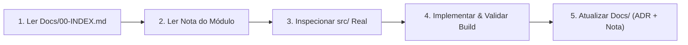

# Convite Carol · 18 Anos (`convitecarol.site`)

> [!info] Mapa Central (MOC — Map of Content)
> Este cofre Obsidian é a **Base de Conhecimento viva** do repositório `convite-carol-18`. Antes de qualquer alteração no código, consulte as notas relacionadas abaixo; após cada alteração, atualize a documentação correspondente.

---

## Visão Geral do Projeto

Convite digital interativo mobile-first para a festa de **18 anos da Carol** (`17 de Julho de 2027`, às `19:30`, horário de Brasília), hospedado em `https://convitecarol.site`.

* **Status Atual:** `Produção / Otimizado 60fps (Auditoria Principal Frontend & Motion Design)` (build Next.js 15 validado sem erros de TypeScript ou geração estática).
* **Ponto Único de Verdade:** `src/config/event.ts` (`EVENT`, `FORMATTED_EVENT_DATE`, `EVENT_TIMESTAMP`).

> [!important] Regras Visuais e Editoriais Invioláveis
> 1. **Paleta Oficial:** Apenas **Azul Royal / Marinho Nobre** (`#071739`, `#0A2463`, `#172554`–`#3B82F6`), **Branco / Papel Off-White Texturizado** (`#FFFFFF` / `#F8FAFC` / `#F1F2F4` / `#EEF2F7`) e **Prata Metálico** (`#E2E8F0`–`#64748B`), com **zero dourado/champagne**.
> 2. **Motivos & Ornamentos:** Na capa (`CoverGate`), o **broche central** (`brasao-barroco-c.png`) é um medalhão puro sem fundo e sem flores acopladas; já **a página/portas bipartidas** exibem em camada separada **laços acetinados em Azul Royal** (`BowGlyph`), **riscos caligráficos chiques**, **estrelas facetadas/brilhantes** e apenas toques sutis de flores/folhas estilizadas em Azul Royal & Prata. No pôster e nas seções internas (`HeroPoster`, `InvitationContent`), utilizam-se **lacinhos de fita acetinada**, cantoneiras geométricas (`CornerFiligree`), estrelas facetadas, globos espelhados e balões glossy.
> 3. **Proibição Estrita de Sugestões de Presentes / Pix:** É terminantemente proibido incluir qualquer menção, botão, modal, ícone, chave Pix ou lista de sugestões de presentes no convite.
> 4. **Data e Traje Oficiais:** **17 de Julho** (`17/07/2027`, às `19:30`) e traje **Esporte Fino** (tons de azul royal e prata reservados à aniversariante).

---

## Stack Tecnológica

| Camada | Tecnologia | Versão (`package.json`) |
| :--- | :--- | :--- |
| Framework | Next.js (App Router) | `^15.5.29` |
| UI Runtime | React / React DOM | `^19.3.1` |
| Linguagem | TypeScript (`strict: true`) | `^5.9.3` |
| Estilização | Tailwind CSS + PostCSS | `^4.3.5` |
| Animações & UI | Framer Motion | `^14.12.0` |
| Ticker de Scroll | GSAP (`gsap.ticker` para Lenis) | `^3.15.1` |
| Smooth Scroll | Lenis (`@studio-freight/lenis`) | `^1.0.42` |
| Partículas | `canvas-confetti` | `^1.9.4` |
| Ícones | `lucide-react` | `^1.72.0` |

---

## Navegação do Vault

* **[[00-visao-geral-e-identidade|00 · Visão Geral e Identidade]]** ([Markdown](./00-visao-geral-e-identidade.md)) — Objetivo, público, frase oficial, paleta inviolável e experiência contínua do convite.
* **[[01-arquitetura-e-estrutura|01 · Arquitetura e Estrutura]]** ([Markdown](./01-arquitetura-e-estrutura.md)) — Árvore de pastas, fluxo de dados, `src/config/event.ts`, divisão Server/Client Components e seções integradas.
* **[[02-envelope-3d-e-animacoes|02 · Capa Bipartida, Pôster Hero e Animações]]** ([Markdown](./02-envelope-3d-e-animacoes.md)) — Máquina de estados de `CoverGate`, física de mola das portas verticais, camadas SVG de `HeroPoster`, confetes e Lenis Smooth Scroll.
* **[[03-design-system-e-responsividade|03 · Design System e Responsividade]]** ([Markdown](./03-design-system-e-responsividade.md)) — Paleta hex/gradientes, tipografia (`Great Vibes`, `Cinzel`, `Plus Jakarta Sans`), papel contínuo texturizado e comportamento Mobile (`100dvh`) vs. Desktop.
* **[[04-deploy-e-infraestrutura|04 · Deploy e Infraestrutura]]** ([Markdown](./04-deploy-e-infraestrutura.md)) — GitHub (`@gomeslxy`), Vercel, domínio `convitecarol.site` (Hostinger DNS) e SEO/Open Graph.
* **[[05-changelog-e-decisoes|05 · Changelog e Decisões (ADRs)]]** ([Markdown](./05-changelog-e-decisoes.md)) — Histórico cronológico das decisões arquiteturais e refatorações.
* **[[06-aprendizados-e-troubleshooting|06 · Aprendizados e Troubleshooting]]** ([Markdown](./06-aprendizados-e-troubleshooting.md)) — Bugs resolvidos, armadilhas de Safari/iOS, hidratação SSR e dicas de ambiente Windows.

---

## Fluxo de Trabalho do Agente

