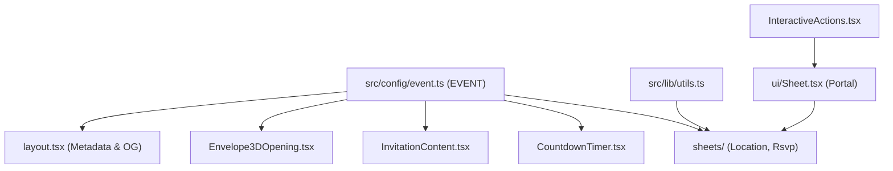

# 01 · Arquitetura e Estrutura

> [!info] Resumo Arquitetural
> A aplicação segue o modelo **Next.js 15 App Router** com geração estática (`○ Static`) na rota `/`, separando configuração e metadados no lado do servidor (`layout.tsx`, `page.tsx`, `event.ts`) da camada interativa 3D e modais no cliente.

---

## Árvore de Arquivos do Projeto

```text
carol/
├─ .agents/skills/obsidian-markdown/SKILL.md  # Skill Obsidian para agentes
├─ Docs/                                      # Cofre Obsidian (Base de Conhecimento)
├─ public/images/                             # Cutout da Carol e adesivos PNG sem fundo
├─ src/
│  ├─ app/
│  │  ├─ globals.css                          # Tema Tailwind v4, linho CSS leve, glass-royal-card 60fps e animações GPU
│  │  ├─ layout.tsx                           # Server Component: fontes, SEO/OG, SmoothScrollProvider
│  │  └─ page.tsx                             # Server Component: entrada principal (<InvitationExperience />)
│  ├─ config/
│  │  └─ event.ts                             # Fonte única de verdade do evento + cache de data
│  ├─ lib/
│  │  └─ utils.ts                             # Clipboard, Google Agenda, .ics, Maps, Waze, WhatsApp
│  └─ components/
│     ├─ InvitationExperience.tsx             # Orquestrador de estágios ("closed" -> "opening" -> "open")
│     ├─ Envelope3DOpening.tsx                # Gateway 3D com forro interno, selo magnético e GSAP timeline
│     ├─ InvitationContent.tsx                # Carta expandida, agenda integrada, GSAP ScrollTrigger e brilho estático
│     ├─ CarolHeroCollage.tsx                 # Colagem editorial da Carol (versão compacta e completa)
│     ├─ CountdownTimer.tsx                   # Contador em cápsulas de cristal com rolagem 3D (React.memo)
│     ├─ InteractiveActions.tsx               # 2 medalhões cromados equilibrados (Local da Festa e Confirmar Presença)
│     ├─ SmoothScrollProvider.tsx             # Contextos separados (ScrollLockContext + SmoothScrollContext)
│     ├─ LuxuryParticles.tsx                  # Confetes calibrados, fireMiniCelebration, estrelas e poeira estelar GPU
│     ├─ BowDecoration.tsx                    # Lacinhos de alta-costura em fita acetinada (royal, silver, duo)
│     ├─ Ornaments.tsx                        # FoilBalloon18, Emblem18, SilverDivider, DressCodeIcon, CornerFiligree
│     ├─ ui/
│     │  └─ Sheet.tsx                         # Modal / Bottom-sheet acessível (Portal, ESC, drag-to-close, cantoneiras)
│     └─ sheets/
│        ├─ SheetButton.tsx                   # Botão reutilizável (link externo ou submit)
│        ├─ LocationSheet.tsx                 # Cartão perolado, mapa embed, copiar endereço, Maps, Waze, Agenda/.ics
│        └─ RsvpSheet.tsx                     # Formulário validado com envio ao WhatsApp e micro-celebração
├─ AGENTS.md / GEMINI.md                      # Protocolo persistente de leitura/escrita em Docs/
└─ next.config.ts                             # reactStrictMode, poweredByHeader: false, optimizePackageImports
```

---

## Separação Server vs. Client Components

| Arquivo | Tipo | Responsabilidade |
| :--- | :--- | :--- |
| `src/app/layout.tsx` | **Server Component** | Carrega fontes (`next/font/google`), gera `metadata` / Open Graph e envolve a árvore no `SmoothScrollProvider`. |
| `src/app/page.tsx` | **Server Component** | Renderiza `<InvitationExperience />` permitindo pré-renderização estática da página. |
| `src/components/CarolHeroCollage.tsx` | **Shared / Puro** | Sem estado nem hooks de cliente; utiliza CSS puro GPU-accelerated (`memo`). |
| `src/components/BowDecoration.tsx` & `Ornaments.tsx` | **Shared / Puro** | SVGs vetoriais puros com `useId` e `memo`. |
| Demais componentes em `src/components/` | **Client Components** | Interatividade 3D, `useEffect`, `gsap`, `framer-motion`, `createPortal` e timers. |

---

## Configuração Centralizada (`src/config/event.ts`)

Todo o conteúdo editorial e funcional reside em `EVENT` (`EventConfig`):

* **Identidade:** `name: "Carol"`, `initial: "C"`, `age: 18`, `siteUrl: "https://convitecarol.site"`.
* **Data e Fuso:** `dateISO: "2027-07-17T20:30:00-03:00"`, `timeZone: "America/Sao_Paulo"`, `durationHours: 5`.
* **Textos:** Citação de Walt Disney (`quoteText`, `quoteAuthor`), `openingText`, `dressCode: "Esporte Fino"`, `dressCodeNote` e `closingText`.
* **Local (`venue`):** Nome, endereço e `mapsQuery` consumidos por `LocationSheet.tsx` e `lib/utils.ts`.
* **RSVP (`rsvp`):** WhatsApp (`5519971345909`), prazo (`17 de junho de 2027`) e limite de acompanhantes (`maxGuests: 6`).

> [!important] Regra Editorial Inviolável
> Por diretriz do evento, `src/config/event.ts` e os componentes em `src/` **não devem conter** qualquer menção, lista de sugestões de presentes ou chave Pix.

> [!tip] Cache Determinístico de Data
> `getFormattedDate()` usa `formattedDateCache` (`Map`) e exporta `FORMATTED_EVENT_DATE` e `EVENT_TIMESTAMP` pré-computados, garantindo paridade exata entre SSR e cliente sem recriar formatadores `Intl.DateTimeFormat` a cada render.

---

## Fluxo de Dados e Ações Interativas



Veja também: [[02-envelope-3d-e-animacoes]], [[03-design-system-e-responsividade]], [[05-changelog-e-decisoes]].

