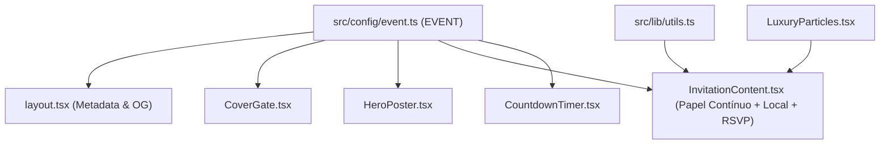

# 01 · Arquitetura e Estrutura

> [!info] Resumo Arquitetural
> A aplicação segue o modelo **Next.js 15 App Router** com geração estática (`○ Static`) na rota `/`, separando configuração e metadados no lado do servidor (`layout.tsx`, `page.tsx`, `event.ts`) da camada interativa contínua no cliente (`CoverGate`, `HeroPoster`, `InvitationContent`).

---

## Árvore de Arquivos do Projeto

```text
carol/
├─ .agents/skills/obsidian-markdown/SKILL.md  # Skill Obsidian para agentes
├─ Docs/                                      # Cofre Obsidian (Base de Conhecimento)
├─ public/images/                             # carol-cutout.png, brasao-barroco-c.png (broche puro 576x610) e cover-ornament-backdrop-right.png (370x1404)
├─ src/
│  ├─ app/
│  │  ├─ globals.css                          # Tema Tailwind v4, bg-paper-fine, bg-poster-paper e animações GPU
│  │  ├─ layout.tsx                           # Server Component: fontes, SEO/OG, SmoothScrollProvider
│  │  ├─ page.tsx                             # Server Component: entrada principal (<InvitationExperience />)
│  │  ├─ icon.tsx                             # Favicon PNG 64x64 (monograma C em Azul Royal e Prata)
│  │  ├─ apple-icon.tsx                       # Apple Touch Icon PNG 180x180 para iOS
│  │  ├─ opengraph-image.tsx                  # Card Open Graph 1200x630 (next/og) para WhatsApp/redes
│  │  ├─ robots.ts                            # Diretivas de indexação apontando para sitemap.xml
│  │  └─ sitemap.ts                           # Sitemap XML oficial de https://convitecarol.site
│  ├─ config/
│  │  └─ event.ts                             # Fonte única de verdade do evento + cache de data
│  ├─ lib/
│  │  └─ utils.ts                             # Clipboard, Google Agenda, .ics, Maps, Waze, WhatsApp, sanitização & validação RSVP
│  ├─ components/
│  │  ├─ InvitationExperience.tsx             # Orquestrador de estágios ("closed" -> "opening" -> "open") + dynamic import de InvitationContent
│  │  ├─ CoverGate.tsx                        # Capa bipartida em papel #F4F5F7, moldura #B8C0CC/#0A2463 e brasão barroco PNG transparent
│  │  ├─ HeroPoster.tsx                       # Pôster animado em código + estrelas exportadas (GlitterBlueStar, MetallicSilverStar)
│  │  ├─ InvitationContent.tsx                # Papel contínuo #F1F2F4: pôster + apresentação + countdown (dynamic) + mapa lazy + RSVP blindado
│  │  ├─ CountdownTimer.tsx                   # Contador no estilo do pôster com pílulas royal-navy e rolagem 3D (React.memo)
│  │  ├─ SmoothScrollProvider.tsx             # ScrollLockContext + Lenis em RAF nativo (lerp: 0.12)
│  │  ├─ LuxuryParticles.tsx                  # Confete calibrado (fireMiniCelebration para o RSVP)
│  │  ├─ BowDecoration.tsx                    # Lacinhos de alta-costura em fita acetinada (royal, silver, duo)
│  │  └─ Ornaments.tsx                        # CornerFiligree geométrica em prata metálica (zero flores)
├─ AGENTS.md / GEMINI.md                      # Protocolo persistente de leitura/escrita em Docs/
└─ next.config.ts                             # reactStrictMode, poweredByHeader: false, images AVIF/WebP, headers de segurança e optimizePackageImports
```

---

## Separação Server vs. Client Components

| Arquivo | Tipo | Responsabilidade |
| :--- | :--- | :--- |
| `src/app/layout.tsx` | **Server Component** | Carrega fontes (`next/font/google`), gera `metadata` / Open Graph e envolve a árvore no `SmoothScrollProvider`. |
| `src/app/page.tsx` | **Server Component** | Renderiza `<InvitationExperience />` permitindo pré-renderização estática da página. |
| `src/components/BowDecoration.tsx` & `Ornaments.tsx` | **Shared / Puro** | SVGs vetoriais puros com `useId` e `memo` (`Bow`, `CornerFiligree`). |
| Demais componentes em `src/components/` | **Client Components** | Interatividade, `CoverGate`, `HeroPoster`, `InvitationContent` (Local & RSVP integrados com `whileInView`), `CountdownTimer` e Lenis. |

---

## Configuração Centralizada (`src/config/event.ts`)

Todo o conteúdo editorial e funcional reside em `EVENT` (`EventConfig`):

* **Identidade:** `name: "Carol"`, `initial: "C"`, `age: 18`, `siteUrl: "https://convitecarol.site"`.
* **Data e Fuso:** `dateISO: "2027-07-17T19:30:00-03:00"`, `timeZone: "America/Sao_Paulo"`, `durationHours: 5`.
* **Textos:** Citação de Walt Disney (`quoteText`, `quoteAuthor`), `openingText`, `dressCode: "Esporte Fino"`, `dressCodeNote` e `closingText`.
* **Local (`venue`):** Nome, endereço e `mapsQuery` consumidos diretamente na seção Local da Festa em `InvitationContent.tsx` e `lib/utils.ts`.
* **RSVP (`rsvp`):** WhatsApp (`5519971345909`), prazo (`17 de junho de 2027`) e limite de acompanhantes (`maxGuests: 6`).

> [!important] Regra Editorial Inviolável
> Por diretriz do evento, `src/config/event.ts` e os componentes em `src/` **não devem conter** qualquer menção, lista de sugestões de presentes ou chave Pix.

> [!tip] Cache Determinístico de Data
> `getFormattedDate()` usa `formattedDateCache` (`Map`) e exporta `FORMATTED_EVENT_DATE` e `EVENT_TIMESTAMP` pré-computados, garantindo paridade exata entre SSR e cliente sem recriar formatadores `Intl.DateTimeFormat` a cada render.

---

## Fluxo de Dados e Seções Integradas



Veja também: [[02-envelope-3d-e-animacoes]], [[03-design-system-e-responsividade]], [[05-changelog-e-decisoes]].
