# 02 · Capa Bipartida (`CoverGate`), Pôster Hero (`HeroPoster`) e Animações

> [!important] Princípio de Performance 60fps
> Toda a coreografia de abertura, os ladrilhos dos globos espelhados, o *parallax* e os ornamentos operam exclusivamente sobre `transform` (`translate3d`, `scale`, `rotate`) e `opacity`, sem animar `filter: blur(...)`, `height: "auto"` ou `<feTurbulence>`.

---

## Máquina de Estados (`InvitationExperience` + `CoverGate`)

`InvitationExperience.tsx` gerencia o ciclo de vida macro (`Stage = "closed" | "opening" | "open"`), enquanto `CoverGate.tsx` executa a coreografia de abertura determinística (`GatePhase = "idle" | "unsealing" | "opening"`) protegida pela trava síncrona `isOpeningRef = useRef(false)` e uma única `gsap.timeline()`.

```mermaid
stateDiagram-v2
    [*] --> idle : "Stage: closed (Metade direita cortada colada à divisória central + broche puro)"
    idle --> unsealing : "Clique/toque no broche (whileTap 0.92 + ondas de choque duplas + 14 fagulhas 1.35s, sem confete)"
    unsealing --> opening : "0.58s — Portas deslizam (-102% / +102%) em 1.95s [0.16, 1, 0.3, 1]; scroll libera e HeroPoster inicia em 0.95s"
    opening --> open : "2.6s — CoverGate desmonta via onOpenComplete()"
    open --> [*]
```

* Se `prefers-reduced-motion: reduce` estiver ativo no sistema operacional, estrelas animadas e shimmer são ocultados, parallax é zerado e a abertura salta diretamente para `opening`, liberando o scroll em `0.25s`.

---

## Arquitetura da Capa Bipartida (`CoverGate.tsx`)

* **Portas Verticais (`50%` esquerda / `50%` direita) + Ilustração Cortada na Divisória (`public/images/cover-ornament-backdrop-right.png`):**
  * Superfície `bg-paper-fine` em papel artesanal off-white/pérola (`#F4F5F7`) com vinheta perimetral sutil, molduras duplas e cantoneiras arquitetônicas minimalistas (`EditorialCornerBracket`) em `#B8C0CC` e `#0A2463`.
  * A metade direita cortada (`370x1404`, ~123 KB, `priority`, `fetchPriority="high"`, `decoding="sync"`) fica **colada na divisória central vertical da porta direita (`left-0`)**, exibindo o laço acetinado Azul Royal, fitas fluidas, filigranas finas e estrelas enquanto mantém livre a área curva de `TOQUE PARA ABRIR`. Ao abrir as portas em `1.95s`, desliza junto com a porta direita.
* **Broche Barroco Puro Sem Fundo (`public/images/brasao-barroco-c.png`):**
  * Imagem PNG recortada (`576x610`, ~242 KB, zero dourado/champagne — relevo em Madrepérola/Prata Frio e monograma `"C"` em Azul Royal, **sem fundo, sem halo circular e sem flores acopladas**), carregada com `<Image priority fetchPriority="high" loading="eager" decoding="sync" />` e `initial={false}` (`CLS = 0`).
  * Flutua sobre a fresta central (`z-30`) com `filter: drop-shadow(...)` realista, micro-flutuação vertical GPU (`animate-crest-float`) e reflexo especular diagonal (`animate-brooch-shimmer`) restrito ao medalhão interno `"C"` (`w-[42%]`).
  * **Texto Curvo Exclusivo à Direita (`CurvedCrestCaption`):** `<svg viewBox="0 0 576 610">` sincronizado com as dimensões reais do broche, desenhando **`TOQUE PARA ABRIR`** diretamente sobre o papel claro ao longo de `<path>` concêntrico à lateral direita do selo, em `Cinzel` (`#071739`) com contorno `#F4F5F7` (`paintOrder: "stroke fill"`) e `animate-breathe-soft`.
  * `will-change: transform` aplicado nas portas e no botão do broche **apenas durante a abertura** (`isUnsealing || isOpening`), economizando memória de camada GPU em repouso.
  * Ao clicar/tocar (`handleTriggerOpen`): resposta tátil rápida (`scale: 0.92`), ondas de choque duplas + explosão de 14 fagulhas estelares (`1.35s`) **sem confete**, seguida pelo deslizamento suave das portas (`1.95s`, scroll liberado já em `0.58s`, `HeroPoster` iniciando em `0.95s` e desmontagem final em `2.6s`).

---

## Arquitetura em Camadas do Pôster Hero (`HeroPoster.tsx`)

Toda a composição é renderizada via código React + Tailwind + SVG + Framer Motion:

1. **Papel Editorial Contínuo (`bg-poster-paper` em `InvitationContent.tsx`):** Trama leve em CSS puro (`--paper-weave` simplificada) sobre base `#F1F2F4` com `overflow-x-clip` estendida sem corte reto do topo do pôster até o rodapé.
2. **Globos Espelhados 3D (`MirrorDiscoBall`):** Projeção esférica procedural determinística (`buildDiscoTiles`) com facetas em prata/grafite/branco, aro especular sutil, brilhos suaves sem `drop-shadow` pesado de GPU e *parallax* no scroll (`useScroll` + `useTransform` respeitando `prefers-reduced-motion`). Entrada cadenciada em `1.85s`.
3. **Letreiro `"HAPPY BiRthdAy"` (`LetterBlock`):** 5 blocos superiores + 8 blocos inferiores em grafia mista com moldura metálica chanfrada, inclinações individuais, entrada *staggered* contemplativa (`0.30s–1.62s`) quando `revealed` e micro-interação ao toque/hover.
4. **Estrelas com Parallax (`GlitterBlueStar` / `MetallicSilverStar`):** Estrelas de 5 pontas envolvidas em wrappers `motion.div` com *parallax* (`starsUpParallax` / `starsDownParallax`) sem loops internos de `animate-twinkle` no pôster; as 6 estrelas da margem inferior permanecem estáticas (`animClass=""`) para manter o scroll leve.
5. **Base Central:** Foto P&B recortada da Carol bebê (`public/images/carol-cutout.png`, `833x1024`, entrada em `1.65s`) com `loading="lazy"` e `decoding="async"` dentro de container `aspect-[833/1024]` único e coordenadas puramente percentuais: `<Bow variant="royal" />` (`1.75s`) travado no cabelo/faixa superior esquerdo (`top-[11%] left-[25.5%] w-[15.5%] -rotate-[22deg]`), `RoyalGlitterPartyHat` (`1.95s`) travado no topo/lateral superior direito (`-top-[13.5%] right-[11.2%] w-[33.5%] rotate-[24deg]`) com glitter cintilante, sombra de contato e pompom volumoso de 40 fios, e `RoyalGlossyBalloons` (`1.75s`) com flutuação orgânica em bloco único.

---

## Coreografia de Scroll, Confete & Lenis Smooth Scroll

* **Seções Inferiores (`InvitationContent.tsx`):** Cada bloco utiliza `whileInView` individual (`viewport={{ once: true, amount: 0.14 }}`, duração `0.95s`) em vez de containers gigantes de seção, garantindo visibilidade consistente da animação ao rolar, além de `contain: "strict"` no container do `<iframe>` do Google Maps (`h-52 sm:h-60`) e micro-transições (`AnimatePresence mode="wait"`) nos botões de agenda e cópia de endereço.
* `fireMiniCelebration` (`LuxuryParticles.tsx`) importa `canvas-confetti` sob demanda com orçamento calibrado para mobile (`particleCount: 18`) exclusivamente para celebrar a confirmação de presença no formulário RSVP de `InvitationContent.tsx` (confetes ao abrir o broche foram removidos).
* `SmoothScrollProvider` isola `ScrollLockContext` (`lock`, `unlock` estáveis com `lenisRef.current?.resize()` ao destravar), rodando Lenis com `lerp: 0.12`, `wheelMultiplier: 1`, `touchMultiplier: 1` e loop `requestAnimationFrame` nativo com `cancelAnimationFrame` no cleanup.
* Em `CountdownTimer.tsx`, `useCountdown(target, active)` inicia somente com `active={revealed}` e anima dígitos em `RollingDigit` via `rotateX` GPU (sem `will-change-transform` permanente).

Veja também: [[01-arquitetura-e-estrutura]], [[03-design-system-e-responsividade]], [[06-aprendizados-e-troubleshooting]].
