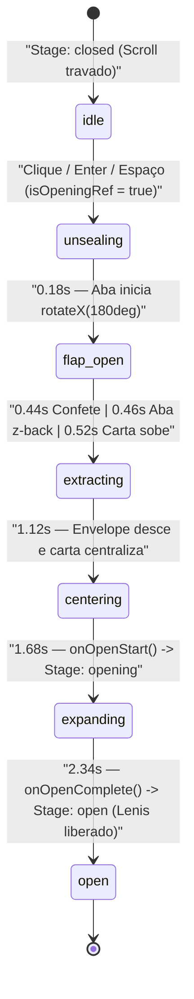

# 02 · Envelope 3D e Animações

> [!important] Princípio de Performance 60fps
> Toda a coreografia 3D e os adesivos flutuantes operam exclusivamente sobre `transform` (`translate3d`, `scale`, `rotateX`, `rotateY`) e `opacity`, sem animar `filter: blur(...)`, `height: "auto"` ou propriedades de layout.

---

## Máquina de Estados (`InvitationExperience` + `Envelope3DOpening`)

`InvitationExperience.tsx` gerencia o ciclo de vida macro (`Stage = "closed" | "opening" | "open"`), enquanto `Envelope3DOpening.tsx` executa a coreografia interna determinística (`OpeningPhase`) orquestrada por uma **única `gsap.timeline()`** protegida por trava síncrona `isOpeningRef = useRef(false)`.

* Se `prefers-reduced-motion: reduce` estiver ativo no sistema operacional, a abertura salta diretamente para `expanding` e libera o scroll em `0.25s`.

---

## Arquitetura 3D Real e Planos `translateZ`

O container da cena 3D utiliza `perspective: 1200px` e `transformStyle: "preserve-3d"`. Para evitar *z-fighting* no Safari/WebKit, cada camada ocupa um plano explícito no eixo Z:

| Camada | Elemento | `translateZ` | Função |
| :--- | :--- | :--- | :--- |
| Piso | Sombra projetada | `-12px` | Profundidade no plano de fundo |
| Camada 1 | Cavidade traseira + Forro (`cavity-liner`) | `-2px` | Fundo escuro Azul Royal com trama geométrica prateada e `--linen-grain` |
| Camada 2 | Folha interna do convite | `2px` -> `14px` | Sobe na extração com sombra dinâmica e vem para frente na centralização |
| Camada 3 | Bolso frontal SVG + oclusão de dobras + sombra da aba | `6px` | Dobras laterais/inferior sombreadas, textura linho, reflexo especular e destinatário |
| Camada 4 | Aba superior triangular (`flap-liner` no verso) | `8px` -> `-1px` | Rotaciona `180deg`, revela forro interno prateado e recua atrás da carta aos `0.46s` |
| Camada 5 | Selo de joalheria `"C · 18"` + `<Bow variant="silver" />` | `18px` | Selo com aro chanfrado, tração magnética isolada e ondas de choque duplas ao abrir |

---

## Paralaxe, Giroscópio, Selo Magnético e Reflexo Especular

* **Desktop (Ponteiro):** `onPointerMove` atualiza `useMotionValue` (`pointerX`, `pointerY`), suavizados via `useSpring` (`stiffness: 150, damping: 20, mass: 0.65`) para inclinar o envelope (`rotateX: ±10deg`, `rotateY: ±13deg`) e deslocar o gradiente radial especular (`glareBackground`).
* **Tração Magnética no Selo:** `sealRawX` / `sealRawY` suavizados por `useSpring` (`stiffness: 220, damping: 18`) deslocam sutilmente o selo (`±7px`) em direção ao cursor dentro de um `<motion.div>` filho aninhado ao wrapper estático `translateZ(18px)` (evitando que o Framer Motion sobrescreva o plano 3D no WebKit; veja [[06-aprendizados-e-troubleshooting#^framer-translatez|Troubleshooting]]).
* **Mobile (Giroscópio):** Listener `deviceorientation` (`{ passive: true }`) ativo apenas enquanto `phase === "idle"`.
* **Reflexo Especular Reativo na Carta (`InvitationContent.tsx`):** `onPointerMove` e listener `scroll` (`{ passive: true }`) agendam via `requestAnimationFrame` a atualização das variáveis CSS `--sheen-x` e `--sheen-y` diretamente no elemento raiz (`rootRef.current.style`), iluminando as camadas `.interactive-sheen` sem gerar nenhum re-render React.

---

## Confetes, Micro-Celebração & Poeira Estelar GPU (`LuxuryParticles.tsx`)

* `fireLuxuryCelebration` importa `canvas-confetti` sob demanda (pré-carregado no mount de `Envelope3DOpening`), cria formas vetoriais customizadas (`shapeFromPath` para estrela de 4 pontas `✦` e cristal lapidado) e retorna uma função de **cleanup** que cancela `setTimeout` e `setInterval` imediatamente caso o componente seja desmontado.
* `fireMiniCelebration` dispara um burst compacto (`particleCount: 28`, `zIndex: 90`) em Azul Royal & Prata ao copiar a chave Pix (`GiftsSheet.tsx`) ou confirmar presença (`RsvpSheet.tsx`).
* `AmbientSparkles` combina estrelas cintilantes (`SPARKLE_POINTS`, `.animate-twinkle`) com partículas de poeira estelar (`STARDUST_MOTES`, `.animate-stardust` / `@keyframes stardust-drift` em `translate3d` + `opacity`).

---

## Lenis Smooth Scroll, ScrollTrigger & Rolagem 3D no Contador

* `SmoothScrollProvider` divide o estado em dois contextos:
  * `ScrollLockContext` (`lock`, `unlock` estáveis via `useCallback`): consumido por `useScrollLock(active)` em `Envelope3DOpening.tsx` e `Sheet.tsx` sem causar re-renders quando a instância `lenis` é criada.
  * `SmoothScrollContext`: expõe `lenis` junto com `lock`/`unlock`.
* Um contador interno `lockCount` suporta travas aninhadas (envelope + modais), alternando a classe `html.scroll-locked` e `lenis.stop()` / `lenis.start()`.
* O ticker do GSAP (`gsap.ticker.add(tick)`) dirige o `lenis.raf(time * 1000)` e sincroniza `ScrollTrigger.update`, com `ScrollTrigger.refresh()` acionado assim que `stage === "open"` e após alternar o seletor `"Salvar na Agenda"`.
* Em `CountdownTimer.tsx`, `RollingDigit` anima a troca numérica com rolagem vertical 3D em GPU (`rotateX: ±38deg` + `translateY` dentro de `perspective: 420px`), sem `filter: blur`.

---

## Animações Contínuas em CSS GPU (`InvitationContent` & `CarolHeroCollage`)

Os adesivos decorativos e a poeira estelar usam classes CSS puras (`animate-sticker-float`, `animate-sticker-float-alt`, `animate-sticker-sway`, `animate-stardust` em `src/app/globals.css`) configuradas por variáveis CSS (`--float-duration`, `--ty`, `--r-start`, `--r-mid`, `--stardust-duration`, `--stardust-x`, `--stardust-y`). Enquanto `revealed === false`, o atributo `data-active="false"` pausa todas as animações decorativas via `animation-play-state: paused`.

Veja também: [[01-arquitetura-e-estrutura]], [[03-design-system-e-responsividade]], [[06-aprendizados-e-troubleshooting]].

