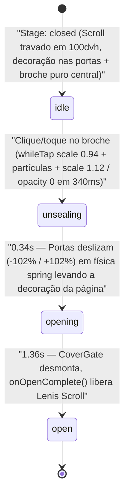

# 02 · Capa Bipartida (`CoverGate`), Pôster Hero (`HeroPoster`) e Animações

> [!important] Princípio de Performance 60fps
> Toda a coreografia de abertura, os ladrilhos dos globos espelhados, o *parallax* e os ornamentos operam exclusivamente sobre `transform` (`translate3d`, `scale`, `rotate`) e `opacity`, sem animar `filter: blur(...)`, `height: "auto"` ou `<feTurbulence>`.

---

## Máquina de Estados (`InvitationExperience` + `CoverGate`)

`InvitationExperience.tsx` gerencia o ciclo de vida macro (`Stage = "closed" | "opening" | "open"`), enquanto `CoverGate.tsx` executa a coreografia de abertura determinística (`GatePhase = "idle" | "unsealing" | "opening"`) protegida pela trava síncrona `isOpeningRef = useRef(false)` e uma única `gsap.timeline()`.

* Se `prefers-reduced-motion: reduce` estiver ativo no sistema operacional, estrelas animadas e shimmer são ocultados, parallax é zerado e a abertura salta diretamente para `opening`, liberando o scroll em `0.20s`.

---

## Arquitetura da Capa Bipartida (`CoverGate.tsx`)

* **Portas Verticais (`50%` esquerda / `50%` direita) + Decoração Independente da Página (`CoverPageCenterOrnament`):**
  * Superfície `bg-paper-fine` em papel artesanal off-white/pérola (`#F4F5F7`) com vinheta perimetral sutil, molduras duplas e cantoneiras caligráficas com estrelas (`EditorialCornerOrnament`) em Azul Royal e Prata.
  * Em camada impressa **sobre as portas da página** (dividida exatamente na junção central via `viewBox="0 0 270 740"` à esquerda e `viewBox="270 0 270 740"` à direita), `CoverPageCenterOrnament` reúne: **3 laços acetinados Azul Royal** (`BowGlyph` de `BowDecoration.tsx`), **riscos caligráficos fluidos chiques**, moldura geométrica vertical alongada, **estrelas facetadas e brilhantes** (`FacetedPageStar`, `FourPointStar` com `animate-spark-twinkle`) e toques botânicos sutis (~20%). Ao abrir as portas, a decoração parte-se e desliza com cada folha de papel.
* **Broche Barroco Puro Sem Fundo (`public/images/brasao-barroco-c.png`):**
  * Imagem PNG recortada (`576x610`, ~242 KB, zero dourado/champagne — relevo em Madrepérola/Prata Frio e monograma `"C"` em Azul Royal, **sem fundo, sem halo circular e sem flores acopladas**), carregada com `<Image priority fetchPriority="high" loading="eager" decoding="sync" />` e `initial={false}` (`CLS = 0`).
  * Flutua sobre a fresta central (`z-30`) com `filter: drop-shadow(...)` realista, micro-flutuação vertical GPU (`animate-crest-float`) e reflexo especular diagonal (`animate-brooch-shimmer`) restrito ao medalhão interno `"C"` (`w-[42%]`).
  * **Texto Curvo Exclusivo à Direita (`CurvedCrestCaption`):** `<svg viewBox="0 0 576 610">` sincronizado com as dimensões reais do broche, desenhando **`TOQUE PARA ABRIR`** diretamente sobre o papel claro ao longo de `<path>` concêntrico à lateral direita do selo (`centro 288, 305`, `raio 324`, `-48°` a `+34°`), em `Cinzel` (`#071739`, `fontSize: 31`, `tracking: 0.17em`) com `animate-breathe-soft`.
  * `will-change: transform` aplicado nas portas e no botão do broche **apenas durante a abertura** (`isUnsealing || isOpening`), economizando memória de camada GPU em repouso.
  * Ao clicar/tocar (`handleTriggerOpen`): resposta tátil *spring* rápida (`scale: 0.94`), explosão de 10 fagulhas estelares (`UNSEAL_SPARKS`) + `fireLuxuryCelebration` (orçamento calibrado para mobile), dissolução do broche (`scale: 1.12, opacity: 0` em `340ms`) seguida pela abertura das portas com física *spring* (`stiffness: 62, damping: 16, mass: 1`).

---

## Arquitetura em Camadas do Pôster Hero (`HeroPoster.tsx`)

Toda a composição é renderizada via código React + Tailwind + SVG + Framer Motion:

1. **Papel Editorial Contínuo (`bg-poster-paper` em `InvitationContent.tsx`):** Trama leve em CSS puro (`--paper-weave`) sobre base `#F1F2F4` estendida sem corte reto do topo do pôster até o rodapé, acompanhada por brilho atmosférico sutil em GPU.
2. **Globos Espelhados 3D (`MirrorDiscoBall`):** Projeção esférica procedural determinística (`buildDiscoTiles`) com facetas em prata/grafite/branco, aro especular sutil, brilhos `animate-disco-glint` e *parallax* no scroll (`useScroll` + `useTransform` respeitando `prefers-reduced-motion`).
3. **Letreiro `"HAPPY BiRthdAy"` (`LetterBlock`):** 5 blocos superiores + 8 blocos inferiores em grafia mista com moldura metálica chanfrada, inclinações individuais, entrada *staggered* por mola (`revealed`) e micro-interação ao toque/hover.
4. **Estrelas com Parallax & Cintilação:** Estrelas de 5 pontas `GlitterBlueStar` (pontos internos com `animate-twinkle`) e `MetallicSilverStar` (cintilação de crista) envolvidas em wrappers `motion.div` com *parallax* (`starsUpParallax` / `starsDownParallax`) sem conflitar com o CSS `animate-sticker-float`.
5. **Base Central:** Foto P&B recortada da Carol bebê (`public/images/carol-cutout.png`, `833x1024`) com `loading="lazy"` e `decoding="async"` dentro de container `aspect-[833/1024]` único e coordenadas puramente percentuais: `<Bow variant="royal" />` travado no cabelo/faixa superior esquerdo (`top-[11%] left-[25.5%] w-[15.5%] -rotate-[22deg]`), `RoyalGlitterPartyHat` travado no topo/lateral superior direito (`-top-[13.5%] right-[11.2%] w-[33.5%] rotate-[24deg]`) com glitter cintilante, sombra de contato e pompom volumoso de 40 fios, e `RoyalGlossyBalloons` com nós inferiores e flutuação assíncrona orgânica por balão.

---

## Coreografia de Scroll, Confetes & Lenis Smooth Scroll

* **Seções Inferiores (`InvitationContent.tsx`):** Cada bloco utiliza Framer Motion `whileInView` com `viewport={{ once: true, amount: 0.2 }}` e *stagger* (`staggerChildren: 0.09`), além de micro-transições (`AnimatePresence mode="wait"`) nos botões de agenda e cópia de endereço.
* `fireLuxuryCelebration` (`LuxuryParticles.tsx`) importa `canvas-confetti` sob demanda e dispara estrelas de 4 pontas (`✦`) e cristais em Azul Royal & Prata no destrave do broche; `fireMiniCelebration` celebra a confirmação de presença no formulário RSVP de `InvitationContent.tsx`.
* `SmoothScrollProvider` isola `ScrollLockContext` (`lock`, `unlock` estáveis com `lenisRef.current?.resize()` ao destravar), sincronizando Lenis + `gsap.ticker` sem `useState` redundante.
* Em `CountdownTimer.tsx`, `useCountdown(target, active)` inicia somente com `active={revealed}` e anima dígitos em `RollingDigit` via `rotateX` GPU.

Veja também: [[01-arquitetura-e-estrutura]], [[03-design-system-e-responsividade]], [[06-aprendizados-e-troubleshooting]].
