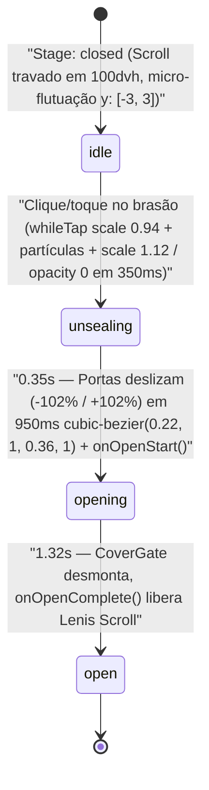

# 02 · Capa Bipartida (`CoverGate`), Pôster Hero (`HeroPoster`) e Animações

> [!important] Princípio de Performance 60fps
> Toda a coreografia de abertura, os ladrilhos dos globos espelhados, o *parallax* e os ornamentos operam exclusivamente sobre `transform` (`translate3d`, `scale`, `rotate`) e `opacity`, sem animar `filter: blur(...)`, `height: "auto"` ou `<feTurbulence>`.

---

## Máquina de Estados (`InvitationExperience` + `CoverGate`)

`InvitationExperience.tsx` gerencia o ciclo de vida macro (`Stage = "closed" | "opening" | "open"`), enquanto `CoverGate.tsx` executa a coreografia de abertura determinística (`GatePhase = "idle" | "unsealing" | "opening"`) protegida pela trava síncrona `isOpeningRef = useRef(false)` e uma única `gsap.timeline()`.

* Se `prefers-reduced-motion: reduce` estiver ativo no sistema operacional, a abertura salta diretamente para `opening` e libera o scroll em `0.20s`.

---

## Arquitetura da Capa Bipartida (`CoverGate.tsx`)

* **Portas Verticais (`50%` esquerda / `50%` direita):** Superfície `bg-paper-fine` em papel artesanal off-white/pérola (`#F4F5F7`), molduras lineares e cantoneiras minimalistas (`EditorialCornerBracket` / `CoverDoorFrame`) em prata fosca (`#B8C0CC`) e azul royal (`#0A2463`), sombra interna (`inset`) e filete prata/azul-marinho na junção central realista.
* **Brasão Barroco Central (`public/images/brasao-barroco-c.png`):** Imagem PNG recortada (`576x610`, fundo 100% transparente sem halo escuro), carregada com `<Image priority fetchPriority="high" loading="eager" decoding="sync" />` e `initial={false}` para *First Paint* instantâneo (`CLS = 0`).
  * Sombras recortadas realistas via `filter: drop-shadow(...)` em múltiplas camadas (nunca `box-shadow`), intensificadas no hover (`scale: 1.04`), aura luminosa discreta em prata/azul royal, reflexo especular diagonal periódico (`animate-brooch-shimmer` sobre máscara radial leve sem requisição HTTP extra) e micro-flutuação vertical GPU (`animate-crest-float`, `y: [-3, 3]` em `4.2s`).
  * `will-change: transform` aplicado nas portas e no botão do brasão **apenas durante a abertura** (`isUnsealing || isOpening`), economizando memória de camada GPU em repouso.
  * Ao clicar/tocar (`handleTriggerOpen`): resposta tátil *spring* rápida (`scale: 0.94`), ondas de choque duplas, dispersão radial de 12 fagulhas estelares (`UNSEAL_SPARKS`) + `fireLuxuryCelebration`, dissolução do brasão (`scale: 1.12, opacity: 0` em `350ms`) seguida pela abertura das portas em `950ms` (`cubic-bezier(0.22, 1, 0.36, 1)`).
  * Chamada de ação **`TOQUE PARA ABRIR`** centralizada abaixo do brasão em `Cinzel` (`tracking-[0.22em]`, `#071739`), área de toque confortável (`min-h-[44px]`) e *pulse* suave de opacidade (`animate-breathe-soft`).

---

## Arquitetura em Camadas do Pôster Hero (`HeroPoster.tsx`)

Toda a composição é renderizada via código React + Tailwind + SVG + Framer Motion:

1. **Papel Editorial Contínuo (`bg-poster-paper` em `InvitationContent.tsx`):** Trama leve em CSS puro (`--paper-weave`) sobre base `#F1F2F4` estendida sem corte reto do topo do pôster até o rodapé, acompanhada por brilho atmosférico sutil em GPU.
2. **Globos Espelhados 3D (`MirrorDiscoBall`):** Projeção esférica procedural determinística (`buildDiscoTiles`) com facetas em prata/grafite/branco, brilhos `animate-disco-glint` e *parallax* no scroll (`useScroll` + `useTransform`) no globo superior esquerdo e inferior direito, além do mini globo superior central encimado por uma estrela azul-marinho.
3. **Letreiro `"HAPPY BiRthdAy"` (`LetterBlock`):** 5 blocos superiores + 8 blocos inferiores em grafia mista com moldura metálica chanfrada, inclinações individuais, entrada *staggered* por mola (`revealed`) e micro-interação ao toque/hover.
4. **Estrelas com Parallax & Cintilação:** Estrelas de 5 pontas `GlitterBlueStar` (pontos internos com `animate-twinkle`) e `MetallicSilverStar` (cintilação de crista) envolvidas em wrappers `motion.div` com *parallax* (`starsUpParallax` / `starsDownParallax`) sem conflitar com o CSS `animate-sticker-float`.
5. **Base Central:** Foto P&B recortada da Carol bebê (`public/images/carol-cutout.png`) em container com `aspect-[451/554]` explícito (zero CLS), `<Bow variant="royal" />` ancorado na têmpora esquerda, chapéu cônico em glitter azul royal com pompom felpudo (`RoyalGlitterPartyHat`) e buquê de 5 balões glossy azul royal (`RoyalGlossyBalloons`) com flutuação assíncrona orgânica por balão.

---

## Coreografia de Scroll, Confetes & Lenis Smooth Scroll

* **Seções Inferiores (`InvitationContent.tsx`):** Cada bloco utiliza Framer Motion `whileInView` com `viewport={{ once: true, amount: 0.2 }}` e *stagger* (`staggerChildren: 0.09`), além de micro-transições (`AnimatePresence mode="wait"`) nos botões de agenda e cópia de endereço.
* `fireLuxuryCelebration` (`LuxuryParticles.tsx`) importa `canvas-confetti` sob demanda e dispara estrelas de 4 pontas (`✦`) e cristais em Azul Royal & Prata no destrave do broche; `fireMiniCelebration` celebra a confirmação de presença no formulário RSVP de `InvitationContent.tsx`.
* `SmoothScrollProvider` isola `ScrollLockContext` (`lock`, `unlock` estáveis com `lenisRef.current?.resize()` ao destravar), sincronizando Lenis + `gsap.ticker` sem `useState` redundante.
* Em `CountdownTimer.tsx`, `useCountdown(target, active)` inicia somente com `active={revealed}` e anima dígitos em `RollingDigit` via `rotateX` GPU.

Veja também: [[01-arquitetura-e-estrutura]], [[03-design-system-e-responsividade]], [[06-aprendizados-e-troubleshooting]].
