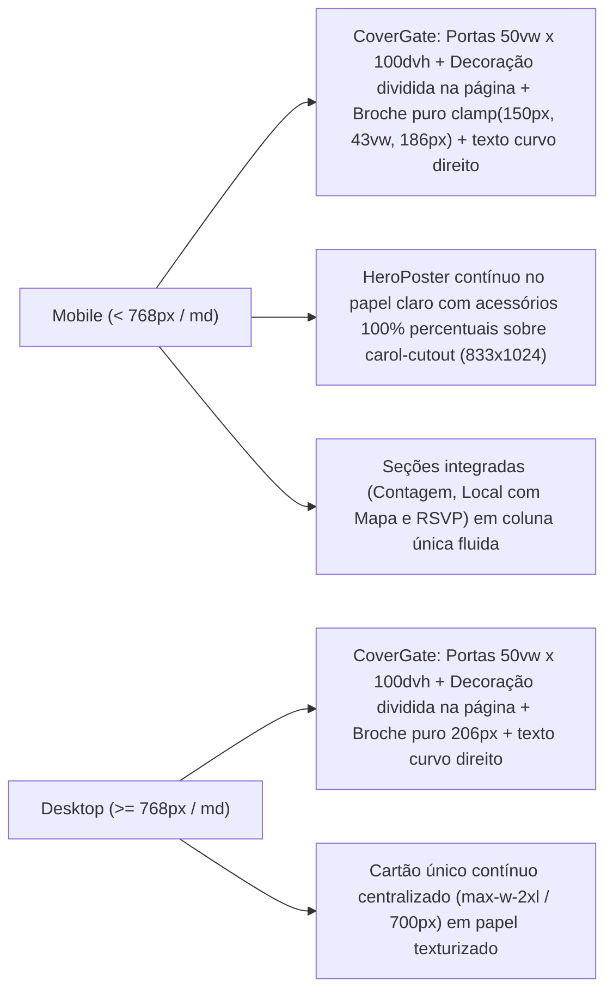

# 03 · Design System e Responsividade

> [!important] Identidade Visual e Regras Editoriais Invioláveis
> * **Cores:** Exclusivamente **Azul Royal / Marinho Nobre**, **Branco / Papel Off-White Gelo** e **Prata Metálico** (**zero dourado ou champagne**).
> * **Motivos:** Na capa (`CoverGate.tsx`), o **broche** é um medalhão puro em Madrepérola/Prata & `"C"` Azul Royal sem fundo e sem flores acopladas; a decoração da **página** (`CoverPageCenterOrnament` nas portas) combina **laços acetinados Azul Royal**, **riscos caligráficos chiques**, **estrelas facetadas** e toques botânicos sutis (~20%). No pôster e conteúdo utilizam-se **lacinhos de fita acetinada**, filigranas geométricas imperiais (`CornerFiligree`), estrelas facetadas (`GlitterBlueStar` e `MetallicSilverStar`), globos espelhados e balões glossy azul royal.
> * **Proibição de Presentes / Pix:** É terminantemente proibido incluir sugestões de presentes, listas de mimos ou chave Pix.
> * **Data e Traje Oficiais:** **17/07/2027** às **19:30** e traje **Esporte Fino**.

---

## Paleta de Cores e Tokens (`src/app/globals.css`)

| Token / Uso | Hexadecimal | Aplicação |
| :--- | :--- | :--- |
| `royal-navy` / `royal-950` | `#071739` / `#172554` | Núcleo profundo do broche, títulos serifados, pílulas (`CAROL • 18 ANOS`, `2027`, rótulos do contador), botões primários e texto editorial |
| `royal-deep` / `royal-900` / `800` | `#0A2463` / `#1E3A8A` / `#1E40AF` | Filetes, ícones, botão Waze, destaques e bordas translúcidas (`1px`) |
| `royal-700` / `600` / `500` | `#1d4ed8` / `#2563eb` / `#3b82f6` | Esmalte do broche, placas do letreiro e foco de inputs |
| `silver-50` / `ice` / `#F4F5F7` | `#f8fafc` / `#f4f5f7` | Papel artesanal off-white/pérola da capa (`bg-paper-fine`) |
| Prata Fosca (`CoverGate`) | `#B8C0CC` | Cantoneiras, molduras lineares minimalistas e filetes da capa bipartida |
| Papel Editorial / `silver-100` / `200` | `#F1F2F4` / `#f1f5f9` / `#eef2f7` / `#e2e8f0` | Fundo contínuo do pôster e do convite (`bg-poster-paper`) |
| `silver-300` / `400` / `500` | `#cbd5e1` / `#94a3b8` / `#64748b` | Aros cromados do broche, estrelas prateadas e bordas metálicas |

### Superfícies Contínuas & Texturas
* `--paper-weave`: Trama sutil em `repeating-linear-gradient` CSS puro (zero `<feTurbulence>`).
* `bg-paper-fine`: Superfície de papel fino artesanal off-white/pérola (`#F4F5F7`) usada nas duas portas da `CoverGate.tsx`, harmonizada com o relevo madrepérola do brasão.
* `bg-poster-paper`: Fundo único contínuo (`#F1F2F4`) aplicado em `InvitationContent.tsx`, envolvendo do topo do `HeroPoster` até o rodapé sem interrupções ou divisões bruscas.
* **Cartões Integrados ao Papel:** Cards leves em `bg-white/75` com borda `1px` translúcida (`border-royal-deep/15`), brilho interno superior (`inset 0 1px 0 rgba(255,255,255,0.9)`) e cantoneiras `CornerFiligree` no card de Local da Festa; todos os botões, inputs e links garantem `min-h-11` (`44px+`).

---

## Tipografia (`src/app/layout.tsx`)

| Variável CSS | Fonte Google | Papel Tipográfico |
| :--- | :--- | :--- |
| `--font-cinzel` (`font-serif`) | `Cinzel` (`400, 500, 600, 700`) | `"TOQUE PARA ABRIR"` na capa, data (`Julho`, `17`), títulos de seção (`Contagem Regressiva`, `Local da Festa`, `Confirmar Presença`), citação e encerramento |
| `--font-jakarta` (`font-sans`) | `Plus Jakarta Sans` (`300, 400, 500, 600`) | Letreiro geométrico, `SÁB`, `19:30`, pílulas (`2027`, `CAROL • 18 ANOS`, rótulos do contador), formulários, endereço e botões |
| `--font-great-vibes` (`font-script`) | `Great Vibes` (`400`) | Monograma sutil `"Carol"` na capa fechada `CoverGate` |

---

## Responsividade: Mobile (`100dvh`) vs. Desktop

Veja também: [[01-arquitetura-e-estrutura]], [[02-envelope-3d-e-animacoes]], [[06-aprendizados-e-troubleshooting]].
