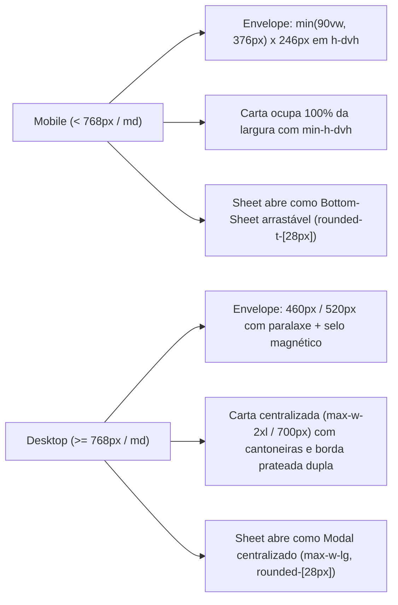

# 03 · Design System e Responsividade

> [!important] Identidade Visual e Regras Editoriais Invioláveis
> * **Cores:** Exclusivamente **Azul Royal**, **Branco / Off-White Perolado** e **Prata Metálico**.
> * **Motivos:** **Zero flores**. Apenas **lacinhos de fita acetinada**, estrelas de 4 pontas (`✦`), balões metalizados (`18`), globo espelhado e adesivos temáticos em PNG sem fundo.
> * **Proibição de Presentes / Pix:** É terminantemente proibido incluir sugestões de presentes, listas de mimos ou chave Pix.
> * **Data e Traje Oficiais:** **17/07/2027** às **20:30** e traje **Esporte Fino**.

---

## Paleta de Cores e Tokens (`src/app/globals.css`)

| Token / Uso | Hexadecimal | Aplicação |
| :--- | :--- | :--- |
| `royal-950` | `#172554` | Profundidade da cavidade do envelope e gradiente da carta |
| `royal-900` | `#1e3a8a` | Títulos internos em sheets, texto secundário no envelope |
| `royal-800` | `#1e40af` | Corpo do envelope, botões `bg-imperial`, ícones dos medalhões |
| `royal-700` | `#1d4ed8` | Destaques, foco de inputs e gradientes acetinados |
| `royal-600` | `#2563eb` | Reflexos claros no envelope e selo central |
| `royal-500` | `#3b82f6` | Luzes especulares suaves sobre o papel azul |
| `silver-50` / `ice` | `#f8fafc` | Fundo base da página, papelaria perolada dos modais |
| `silver-100` / `200` | `#f1f5f9` / `#e2e8f0` | Textos secundários sobre azul royal, gradientes prata |
| `silver-300` / `400` / `500` | `#cbd5e1` / `#94a3b8` / `#64748b` | Bordas metálicas, divisores (`hairline-silver`) e labels |

### Superfícies, Texturas & Utilitários Principais
* `--linen-grain`: Trama fina de linho/algodão implementada com `repeating-linear-gradient` em CSS puro (sem filtros SVG `<feTurbulence>`).
* `bg-royal-letter`: Fundo principal da carta aberta, combinando `--linen-grain`, radiais azuis luminosos e gradiente linear `#0f172a -> #172554 -> #1e3a8a -> #1e40af -> #172554`.
* `glass-royal-card`: Cápsulas e quadros editoriais acetinados em estilo *Liquid Glass 60fps* (usados na citação de Walt Disney, cápsulas do contador, seletor de agenda, card de traje e placas dos medalhões) com gradiente translúcido multicamada, borda especular iluminada e sombra profunda — **sem `backdrop-filter: blur`** para manter 60fps reais no Safari/iOS e Android.
* `glass-pearl-pill`: Pílula perolada opaca/acetinada usada no CTA do envelope 3D (`"Toque no selo para abrir o convite"`), sem `backdrop-filter` sobre camadas 3D.
* `.interactive-sheen`: Camada `::before` com reflexo radial especular estático de joalheria no topo dos cartões.
* `bg-satin`: Superfície perolada limpa usada nos bottom-sheets/modais (`Sheet.tsx`).
* `text-silver-luxury`: Gradiente metálico prateado estático com `background-clip: text` e padding generoso (`padding-inline: 0.22em`, `padding-block: 0.18em`) para impedir corte das ascendentes e descendentes da fonte caligráfica, sem `filter: drop-shadow` nem `animate-shimmer` em loop.

---

## Fidelidade Cromática Estrita nos Feedbacks e Modais

> [!important] Zero Cores Fora da Paleta
> * **`LocationSheet.tsx` & `InvitationContent.tsx`:** Badges de confirmação de cópia/agenda em **Prata Espelhado & Azul Royal** (`bg-silver-100 text-royal-950 ring-1 ring-white`).
> * **`RsvpSheet.tsx`:** Alertas de validação em badge **Azul Royal & Prata** (`bg-royal-900 text-white border border-silver-300/60`), eliminando alertas vermelhos fora da identidade visual.

---

## Tipografia (`src/app/layout.tsx`)

| Variável CSS | Fonte Google | Papel Tipográfico |
| :--- | :--- | :--- |
| `--font-great-vibes` (`font-script`) | `Great Vibes` (`400`) | Nome `"Carol"`, `"Faltam:"`, `"Traje:"`, encerramento e destinatário do envelope |
| `--font-cinzel` (`font-serif`) | `Cinzel` (`400, 500, 600, 700`) | Data, contagem regressiva (`tabular-nums`), rótulos dos medalhões e títulos |
| `--font-jakarta` (`font-sans`) | `Plus Jakarta Sans` (`300, 400, 500, 600`) | Textos de apoio, formulários, subtítulos, notas e botões |

---

## Lacinhos Acetinados de Alta-Costura & Ornamentos Vetoriais

* **`BowDecoration.tsx` (`Bow`):** Renderiza laços acetinados esculturais em 3 variantes (`royal`, `silver`, `duo`) com gradientes cilíndricos de 6 stops, sombra projetada das alças sobre as caudas (`tail-shadow`), 3 pregas convergentes por alça, pontas cortadas em V (*swallowtail*), reflexo especular duplo e nó central abobadado — sem filtros SVG `<feDropShadow>`, usando `drop-shadow` via CSS para nitidez Retina.
* **`Ornaments.tsx`:**
  * `CornerFiligree`: Cantoneira puramente geométrica (linhas duplas entrelaçadas em ângulo reto + estrela de 4 pontas no vértice, **zero elementos florais**) nos tons `light` (carta) e `slate` (`Sheet.tsx`).
  * `FoilBalloon18`: Balão metalizado cromado `"18"` com volume 3D (`fillRule="evenodd"` no dígito `8`) e dobras de mylar.
  * `Emblem18`: Brasão `"C · 18"` com arco duplo pontilhado, micro-estrelas laterais e filete com losango central usado no medalhão do envelope.
  * `SilverDivider` & `DressCodeIcon`: Divisor luminoso com estrela central facetada em 2 camadas + micro-cristais laterais e ícone de vestuário para `"Esporte Fino"`.

---

## Responsividade: Mobile (`100dvh`) vs. Desktop

* **Prevenção de pulos no Mobile:** Uso consistente de `min-h-dvh` e `h-dvh` em vez de `100vh`, além de `pb-[max(28px,env(safe-area-inset-bottom))]` dentro do `Sheet.tsx` para respeitar a barra de gestos do iPhone.
* **Áreas de toque:** Botões dos sheets (`SheetButton.tsx`) e botão `"Salvar na Agenda"` possuem altura mínima `min-h-11` / `min-h-12`, controles de acompanhantes no `RsvpSheet` usam `size-11` (`44px`) e `touch-action: manipulation` global reduz o delay de toque.
* **Contador em cápsulas em telas estreitas (320px–375px):** `CountdownTimer.tsx` usa `grid-cols-4 gap-2 sm:gap-3.5` com `CrystalSeparator` flutuante entre as colunas, ajustando a escala de fonte para `clamp(21px, 5.8vw, 38px)` quando `DIAS` possui 3 dígitos, sem quebra ou overflow horizontal.

Veja também: [[01-arquitetura-e-estrutura]], [[02-envelope-3d-e-animacoes]], [[06-aprendizados-e-troubleshooting]].

