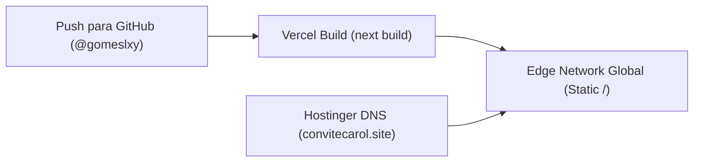

# 04 · Deploy e Infraestrutura

> [!info] Arquitetura de Hospedagem
> * **Repositório GitHub:** `@gomeslxy` (`convite-carol-18`)
> * **Plataforma de Build & Hosting:** Vercel (deploy automático a cada push na branch principal)
> * **Domínio Oficial:** `https://convitecarol.site` (registrado e gerenciado via DNS na **Hostinger**)

---

## Pipeline Vercel & Configuração Next.js

A aplicação é 100% estática (`○ Static` em `/`) e **não requer variáveis de ambiente** (conforme `README.md`).

* **`next.config.ts`:**
  * `reactStrictMode: true`
  * `poweredByHeader: false`
  * `eslint: { ignoreDuringBuilds: true }` (o projeto não utiliza ESLint; a validação de código é garantida por `tsc --noEmit`).
  * `experimental.optimizePackageImports: ["lucide-react", "framer-motion"]`
* **Comandos de Verificação:**
  * Typecheck: `npm run typecheck` (ou `npm.cmd run typecheck` no Windows/PowerShell)
  * Build de produção: `npm run build` (ou `npm.cmd run build`)

---

## Apontamento DNS (Hostinger -> Vercel)

Para o domínio raiz `convitecarol.site` e subdomínio `www.convitecarol.site` apontarem para a Vercel com SSL automático:

| Tipo | Nome / Host | Valor Destino | Finalidade |
| :--- | :--- | :--- | :--- |
| `A` | `@` | `76.76.21.21` | Apontamento do domínio apex (`convitecarol.site`) |
| `CNAME` | `www` | `cname.vercel-dns.com` | Redirecionamento / alias `www` para a Vercel |

> [!warning] Propagação e SSL
> Caso altere registros DNS na Hostinger, aguarde a propagação e confirme na aba **Domains** do projeto na Vercel se o certificado TLS/SSL está emitido como **Valid Configuration**.

---

## SEO & Open Graph (`src/app/layout.tsx`)

Para pré-visualização rica ao compartilhar `https://convitecarol.site` no WhatsApp, Instagram ou Telegram:

* `metadataBase`: `new URL(EVENT.siteUrl)` (`https://convitecarol.site`)
* `alternates.canonical`: `"/"`
* `openGraph`:
  * `title`: `"Carol · 18 Anos"`
  * `description`: `"Save the date — 17 · 07 · 2027 · 20:30. Confirme sua presença!"`
  * `url`: `"/"`, `siteName`: `"Carol · 18 Anos"`, `locale`: `"pt_BR"`, `type`: `"website"`
  * `images`: `[{ url: "/images/carol-cutout.png", width: 800, height: 800, alt: "Carol — 18 Anos" }]`
* `twitter`: `card: "summary_large_image"`

Veja também: [[00-INDEX]], [[01-arquitetura-e-estrutura]], [[05-changelog-e-decisoes]].

