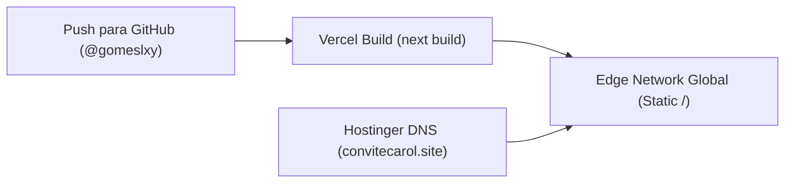

# 04 · Deploy e Infraestrutura

> [!info] Arquitetura de Hospedagem
> * **Repositório GitHub:** `@gomeslxy` (`convite-carol-18`)
> * **Plataforma de Build & Hosting:** Vercel (deploy automático a cada push na branch principal)
> * **Domínio Oficial:** `https://convitecarol.site` (registrado e gerenciado via DNS na **Hostinger**)

---

## Pipeline Vercel & Configuração Next.js

A aplicação é 100% estática (`○ Static` em `/`) e **não requer variáveis de ambiente** (nenhum segredo ou `NEXT_PUBLIC_*` exposto no bundle cliente).

* **`next.config.ts`:**
  * `reactStrictMode: true`
  * `poweredByHeader: false`
  * `eslint: { ignoreDuringBuilds: true }` (o projeto não utiliza ESLint; a validação de código é garantida por `tsc --noEmit`).
  * `images: { formats: ["image/avif", "image/webp"] }`
  * `experimental.optimizePackageImports: ["lucide-react", "framer-motion"]`
  * `headers()` globais (`/(.*)`): `X-Content-Type-Options: nosniff`, `X-Frame-Options: SAMEORIGIN`, `Referrer-Policy: strict-origin-when-cross-origin` e `Permissions-Policy: camera=(), microphone=(), geolocation=()`.
* **Comandos de Verificação:**
  * Typecheck: `npm run typecheck` (ou `npm.cmd run typecheck` no Windows/PowerShell)
  * Build de produção: `npm run build` (ou `npm.cmd run build`)

---

## Apontamento DNS (Hostinger -> Vercel)

Para o domínio raiz `convitecarol.site` e subdomínio `www.convitecarol.site` apontarem para a Vercel com SSL automático:

| Tipo | Nome / Host | Valor Destino | Finalidade |
| :--- | :--- | :--- | :--- |
| `A` | `@` | `76.76.21.21` | Apontamento do domínio apex (`convitecarol.site`) |
| `CNAME` | `www` | `cname.vercel-dns.com` | Redirecionamento / alias `www` para a Vercel |

> [!warning] Propagação e SSL
> Caso altere registros DNS na Hostinger, aguarde a propagação e confirme na aba **Domains** do projeto na Vercel se o certificado TLS/SSL está emitido como **Valid Configuration**.

---

## SEO & Open Graph (`src/app/layout.tsx`, `opengraph-image.tsx`, `robots.ts`, `sitemap.ts`)

Para pré-visualização rica ao compartilhar `https://convitecarol.site` no WhatsApp, Instagram ou Telegram:

* `metadataBase`: `new URL(EVENT.siteUrl)` (`https://convitecarol.site`)
* `title`: `{ default: "Carol — 18 Anos | Convite Oficial", template: "%s | Carol — 18 Anos" }`
* `description`: `"Você é meu convidado especial para celebrar os meus 18 anos no dia 17 de Julho, às 19:30. Confirme sua presença e confira os detalhes."`
* `authors` / `creator` / `publisher`: `Lucas Gomes do Amaral` (`https://github.com/gomeslxy`)
* `alternates.canonical`: `"/"`
* `openGraph` & `twitter`:
  * Imagem gerada dinamicamente em `src/app/opengraph-image.tsx` (`1200x630`, `next/og` `ImageResponse`) em Azul Royal acetinado, moldura e laço minimalista em prata e tipografia `"Carol — 18 Anos • 17 de Julho às 19:30"`.
  * `url`: `"/"`, `siteName`: `"Carol — 18 Anos"`, `locale`: `"pt_BR"`, `type`: `"website"`, `twitter.card`: `"summary_large_image"`.
* **Favicons & Ícones:** `src/app/icon.tsx` (`64x64` PNG) e `src/app/apple-icon.tsx` (`180x180` PNG) com monograma `"C"` em Azul Royal e Prata.
* **Indexação:** `src/app/robots.ts` e `src/app/sitemap.ts` apontando para `https://convitecarol.site`.

Veja também: [[00-INDEX]], [[01-arquitetura-e-estrutura]], [[05-changelog-e-decisoes]].

